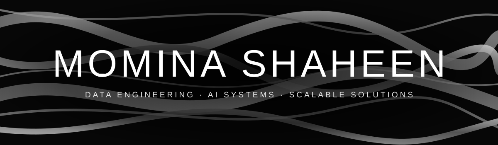

  

&nbsp;

&nbsp;

&nbsp;

---

## About Me

Hey, I'm Momina 👋

I'm a Computer Science student who got hooked on what happens *before* the model: the messy data, the broken pipelines, the "why is this column full of nulls?" moments. Somewhere between cleaning CSVs and wondering how systems survive real traffic, I realized that's the part I enjoy most.

I like building AI systems that do something genuinely useful, and I'm drawn to anything that needs clear logic and a solid foundation. Right now that means my **Financial & Market Intelligence Copilot**: an AI research assistant that reads company financial reports, pulls the numbers from a database, and answers questions with evidence and source citations.

I'm the kind of person who says "just one more fix" and looks up an hour later. Away from the screen, you'll find me with a book or on a badminton court: one lets me get lost in someone else's world, the other lets me smash a shuttlecock when my code refuses to cooperate.

▶️ Building: **Financial & Market Intelligence Copilot**

▶️ Learning: **advanced AI/ML concepts, LLM / RAG systems and advanced SQL**

▶️ Open to: **collaborating on data & AI projects, and new opportunities**

▶️ Ask me about: **AI/ML, LLMs, or how to survive a messy CSV**

▶️ Fun fact: **I once spent two hours debugging one missing comma, and I still call it "a learning experience."**

---

## Tech Stack

**AI / ML DOMAINS**

         

**AI / ML & DATA**

&nbsp;&nbsp;

&nbsp;&nbsp;

&nbsp;&nbsp;

&nbsp;&nbsp;

**DATA VISUALIZATION & BI**

**DATA ENGINEERING**

**DATABASES / RETRIEVAL**

`Vector Search` · `RAG` · `Chroma` · `pgvector`

**CLOUD & TOOLS**

---

## Featured Projects

| Project | What it does | Tech |
|---|---|---|
| **Financial & Market Intelligence Copilot** | AI research assistant that answers financial questions from company reports and database figures, with source citations | **[tech]** |
| [csv-data-analysis-python](https://github.com/momna-shaheen/csv-data-analysis-python) | Analyzes CSV data using Pandas | Python, Pandas |
| **[Project 3]** | **[one-line description]** | **[tech]** |

---

## GitHub Activity

  

<picture>
  <source media="(prefers-color-scheme: dark)" srcset="https://raw.githubusercontent.com/momna-shaheen/momna-shaheen/output/github-snake-dark.svg" />
  <source media="(prefers-color-scheme: light)" srcset="https://raw.githubusercontent.com/momna-shaheen/momna-shaheen/output/github-snake.svg" />
  
</picture>

---

*Always learning, always building.*

